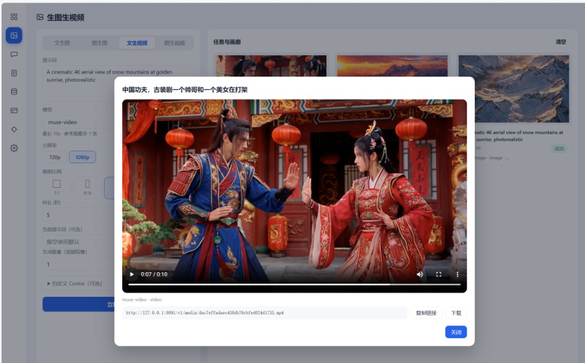

# Muse 协议网关

一句话交给它，它还你一段对话、一张画面，或一条能打开的片子。

账号不必一封封手工注册。邮箱物料进去，协议自己把号养到能用；接着用同一套 OpenAI 兼容接口说话、生图、生视频。成片不散落在日志里：任务画廊里点开，就能预览、复制链接、下载。



*文生视频完成后，在「任务与画廊」里直接预览。上面这条片子的提示词是「中国功夫，古装剧一个帅哥和一个美女在打架」。*

## 你能拿它做什么

| 能力 | 你会看到什么 |
|------|----------------|
| 协议注册 | 导入邮箱，自动取验证码、完成年龄验证、设密，号进入号池 |
| 对话 | `muse-spark`，支持流式输出 |
| 生成图片 | 文生图、图生图，`muse-image` |
| 生成视频 | 文生视频、图生视频，`muse-video`，成片在浮层里播放 |
| 号池 | 区分「已注册待分配」和「可用」；待分配的号会自动去租工作区 |
| 管理台 | 总览、生图生视频、对话、生成记录、号池、卡池、补号、设置 |

对外只暴露 `/v1`。默认走纯协议引擎选号与生成；调用方带自己的 Key，网关选号、暖连接复用、回写媒体地址。Cookie 和卡号不出现在列表和日志里。

## 协议引擎（默认）

默认 `ENGINE_BACKEND=protocol`：经 Noise WebSocket + `chat.stream` 直接请求 Muse，不再依赖本机 Chromium/CDP。

| 项 | 说明 |
|----|------|
| 文本 / 图片 | `/v1` 已实测可走协议路径；图片结果会本地转为真实 PNG 交付 |
| 视频 | 协议链路已实现；大规模端到端验收仍有限，请按任务实际结果为准 |
| 代理 | 支持 `host:port:user:pass` 四段字符串（默认 http，密码可含冒号），以及原有 URL / `user:pass@host:port` / IPv6 |
| 连接复用 | 同账号可复用已建立的 Noise 会话与订阅（暖连接），降低重复 bootstrap |
| 并发 | **同号串行**（文本默认同号 1；图/视频始终串行）；跨号可并行，受号池与上游限额约束 |
| 计时 | 非流式 `/v1/chat/completions` 响应含 `muse_timing`（匿名 account_slot、reuse、renew/bootstrap 等，不含 prompt/密钥） |
| 未支持 | confidential / 未处理的 CVM 资格不会静默回退 CDP；断线自动完整恢复策略仍有限，失败时按现有轮换与重试处理 |

## 环境

- Python 3.10 及以上
- 默认监听 `8090`。若本机该端口已被占用，在 `.env` 里改 `PORT` 和 `PUBLIC_BASE`

## 安装与启动

```bash
python3 -m venv .venv
source .venv/bin/activate   # Windows: .venv\Scripts\activate
pip install -r requirements.txt
cp .env.example .env
```

至少改这三项再启动：

| 变量 | 作用 |
|------|------|
| `ADMIN_PASSWORD` | 管理台登录密码，不要沿用 `change-me` |
| `SESSION_SECRET` | 会话签名 |
| `MUSE_PROXY_KEY` | 调用 `/v1` 的对外 Key |

可选：`ENGINE_BACKEND=protocol`（默认）或 `cdp`/`local`（Chromium）。

```bash
uvicorn app.main:app --host 0.0.0.0 --port 8090
```

- 健康检查：`GET /healthz`、`GET /readyz`
- 管理台：<http://127.0.0.1:8090/login.html>
- 默认账号：`admin`，密码为 `.env` 中的 `ADMIN_PASSWORD`

## 管理台

登录后从左侧进入。生成类页面和记录页分开：对话不会出现在生图、生视频的记录里。

| 页面 | 地址 | 用途 |
|------|------|------|
| 总览 | `#overview` | 成功率、上游健康、号池与 Key 概况 |
| 生图生视频 | `#generate` | 文生图、图生图、文生视频、图生视频；右侧为任务与画廊 |
| 对话 | `#chat` | 选择对话模型，流式或整段返回 |
| 生成记录 | `#records` | 图片和视频调用记录，可筛选、看详情、清理 |
| 号池管理 | `#accounts` | 导入、检测、额度、启用停用 |
| 卡池管理 | `#cards` | 导入卡、掩码展示、恢复或停用 |
| 补号系统 | `#refills` | 邮箱物料、批量注册、保活 |
| 系统设置 | `#settings` | 引擎、注册、调度、网络、存储、安全 |

任务与画廊里，同一条任务只保留一张卡片。进行中显示进度，完成后换成成片。点击卡片打开浮层，可以复制媒体链接或下载文件。

## 对外接口

鉴权头：`Authorization: Bearer <MUSE_PROXY_KEY 或设置页创建的 Key>`。

下面的示例假定服务在 `127.0.0.1:8090`，且 `KEY` 与 `.env` 里的 `MUSE_PROXY_KEY` 一致。

```bash
export KEY=mprox_dev_replace_me

# 模型
curl -sS http://127.0.0.1:8090/v1/models \
  -H "Authorization: Bearer $KEY"

# 对话（流式）
curl -N http://127.0.0.1:8090/v1/chat/completions \
  -H "Authorization: Bearer $KEY" -H "Content-Type: application/json" \
  -d '{"model":"muse-spark","stream":true,"messages":[{"role":"user","content":"用三句话介绍一座临海的城"}]}'

# 图片
curl -sS http://127.0.0.1:8090/v1/images/generations \
  -H "Authorization: Bearer $KEY" -H "Content-Type: application/json" \
  -d '{"model":"muse-image","prompt":"a cat"}'

# 异步图片任务：POST /v1/images/tasks ，查询 GET /v1/images/tasks/{id}
# 图生图：POST /v1/images/edits （multipart，字段 model、prompt、image）

# 视频
curl -sS -X POST http://127.0.0.1:8090/v1/videos \
  -H "Authorization: Bearer $KEY" -H "Content-Type: application/json" \
  -d '{"model":"muse-video","prompt":"wave"}'
# 查询：GET /v1/videos/{id}
```

媒体地址默认改写到 `PUBLIC_BASE/v1/media/{name}`。`MEDIA_AUTH_REQUIRED=true` 时，下载该地址需要 Bearer；管理台里已登录的浏览器可以用会话 Cookie 直接看图和播放视频。

调用会写入 `call_logs`：时间、路径、模型、状态、耗时、错误摘要、Key 前缀。不保存完整密钥，也不保存图片的 base64。

### 状态码

| 状态 | 含义 |
|------|------|
| 401 | 未带 Key，或 Key 无效 |
| 403 | Key 已停用，或模型不在白名单 |
| 429 | 并发已满，或额度 / 日限用尽 |
| 502 | 上游不可达 |
| 504 | 上游超时 |

环境变量 Key 和试调短时 Key 不扣额度。设置页创建的用户 Key 在成功响应后记一次用量；`CHARGE_ON_UPSTREAM_ERROR=true` 时，上游失败也记一次。`GET /v1/media/*` 不扣额度。

创建用户 Key 的明文只在创建或轮换的响应里出现一次，库中只存哈希和前缀。

## 协议注册

补号系统把一条邮箱物料跑成一个可登录、可生成的号。主路径如下。

```text
导入邮箱
  → restart → send-otp
  → 自动收取验证码（IMAP XOAUTH2，其次 IMAP 密码，再次 Graph）
  → confirm-otp → register-completion
  → 从卡池取卡，完成 1 美元年龄验证
  → accept-tos → 租用 standard 工作区
  → 自动设密，密码加密保存
  → 写入号池（Cookie、指纹、登录密码）
```

物料格式：

```text
邮箱----密码----ClientID----RefreshToken
邮箱----密码----ClientID----RefreshToken----辅邮----辅密
```

也接受竖线、制表符分隔。注册并发在设置里调整，范围 1 到 10。代理模板中的 `{sid}` 会在每次注册时换成 8 位随机串；代理失败会换新的 SID 再试。

工作区未租到时，注册仍然成功，号在号池里标为「已注册待分配」。后台会继续租用，租到之后变为可用。只有会话真正失效（401）才会判定登录态无效。

注册接口不接受卡号、有效期、CVV。这些字段只允许出现在卡池接口里。

## 卡池

卡只用于注册过程中的年龄验证。列表展示品牌和末四位，主账号和安全码以密文保存。

| 状态 | 含义 |
|------|------|
| `available` | 可取用 |
| `in_use` | 正在支付 |
| `used` | 已成功使用 |
| `failed` | 软失败，可以恢复后重试 |
| `dead` | 硬拒绝，不再使用 |
| `disabled` | 手动停用 |

导入示例（需先登录管理台，把 Cookie 放在 `cj` 里）：

```bash
curl -b cj -X POST http://127.0.0.1:8090/api/cards/import \
  -H "Content-Type: application/json" \
  -d '{"text":"4111111111111111|12/28|123|10001|US","source":"sample"}'
```

相关变量：`CHECKOUT_ENABLED`、`CHECKOUT_AMOUNT`、`CHECKOUT_CURRENCY`、`CHECKOUT_MAX_CARD_TRIES`、`CHECKOUT_PTT_MODE`（`jwe` 或 `direct`）。`direct` 只用于链路联调，不要用于生产。

## 配置

完整模板见 `.env.example`。常用项如下。

| 变量 | 默认 | 说明 |
|------|------|------|
| `PORT` / `PUBLIC_BASE` | `8090` | 监听端口，以及写进媒体链接的对外根地址 |
| `ENGINE_BACKEND` | `protocol` | `protocol`：Noise XX + `chat.stream` 纯协议生成，不启动 Chromium；`cdp`（或旧值 `local`）：保留的 Chromium/CDP 引擎。设置页也可切换；管理台运行时覆盖优先于 `.env` |
| `SIGNUP_CLIENT` | `http` | `http` 走真实站点；`mock` 只用于本地演练 |
| `SIGNUP_MUSE_BASE` | `https://muse.ai` | 注册协议的站点根地址 |
| `SIGNUP_TLS_IMPERSONATE` | `chrome` | 浏览器 TLS 指纹；`off` 则退回普通 HTTP 客户端 |
| `SIGNUP_AUTO_PASSWORD` | `true` | 激活后自动设密 |
| `SIGNUP_MAIL_WAIT_SEC` | `90` | 等待验证码或恢复码的最长时间 |
| `MAX_CONCURRENCY` | `8` | 对外生成并发上限 |
| `REWRITE_MEDIA_URLS` | `true` | 把媒体地址改写到本网关 |
| `MEDIA_AUTH_REQUIRED` | `true` | 媒体下载是否要求 Key |
| `CONSOLE_GENERATE_ENABLED` | `true` | 是否允许管理台试调 |
| `RECORD_KEEP_DAYS` | `30` | 调用记录保留天数 |

代理写在系统设置的代理列表中，不要写进仓库。

## 目录

```text
├── app/
│   ├── main.py                 # 应用入口
│   ├── routers/                # 管理接口与 /v1
│   ├── signup/                 # 协议注册、指纹、代理 SID
│   ├── muse_engine/            # 对话、生图、生视频
│   └── pool/                   # 号池
├── static/                     # 管理台
├── docs/images/intro.jpg       # 本文介绍图
├── .env.example
└── requirements.txt
```

更细的协议笔记见 `docs/muse-auth-protocol-full.md` 与 `docs/engine-local.md`。

## 安全

- `.env`、数据库和卡池密文不要提交。
- 管理台默认口令必须在首次登录前修改。
- 导出卡池明文只在管理员本机使用。
- 文档和示例里的 Key 都是占位符，换成自己的值后再调用。
