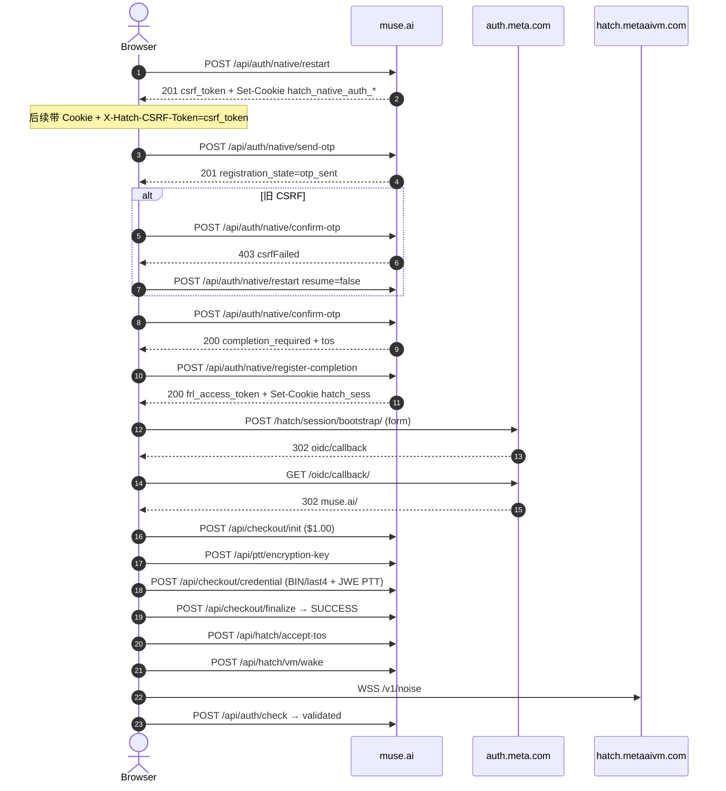
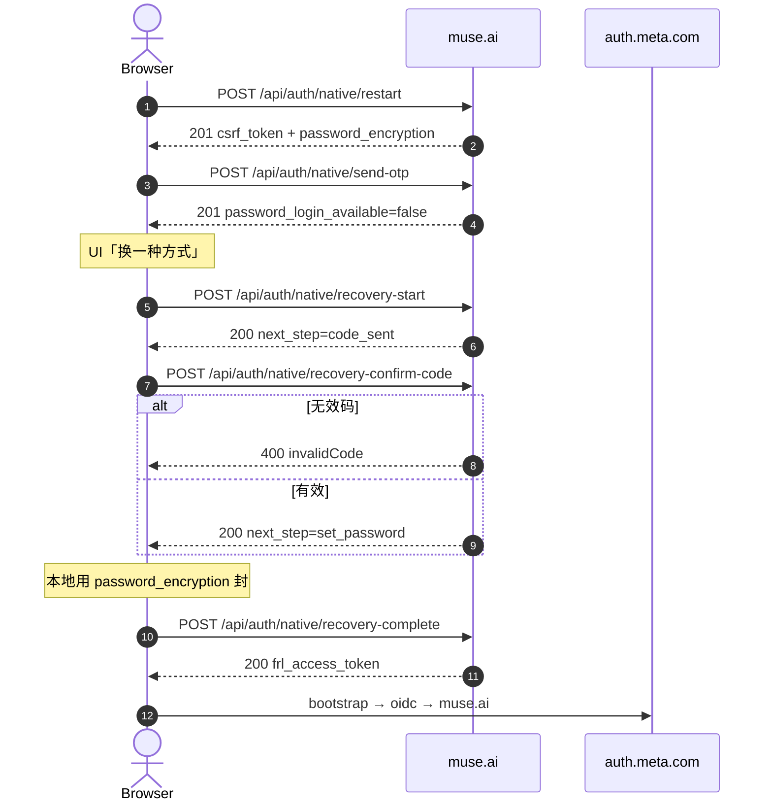
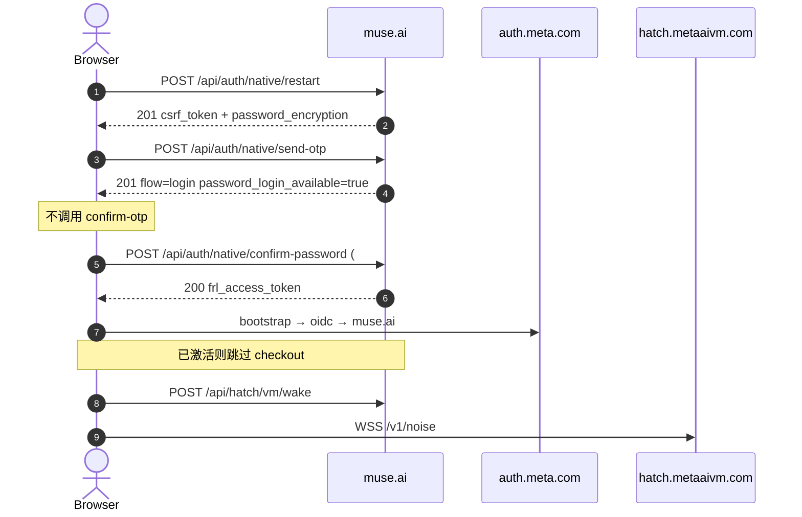

# Muse.ai 认证协议完整流程（抓包逆向）

> **性质：** 协议对照 / 抓包复盘文档，仅记录 HAR 与浏览器会话中**已观测**的接口、字段与时序。  
> **不是**可复用的自动化注册/登录脚本说明，也不提供绕过风控或批量滥用步骤。  
> **生成时间：** 2026-11-05（Asia/Shanghai）  
> **原则：** 字段以源 HAR / 会话笔记为准；推断单独标注「推断」。敏感值一律截断或脱敏（OTP、FRLA、JWT、PAN、密码明文、cookie 实值）。

---

## 目录

1. [概要与抓包账号](#1-概要与抓包账号)
2. [会话引导：获取 Cookie + `x-hatch-csrf-token`](#2-会话引导获取-cookie--x-hatch-csrf-token)
3. [新注册流程（邮箱 OTP）](#3-新注册流程邮箱-otp)
4. [通过 Recovery 设置密码](#4-通过-recovery-设置密码)
5. [密码登录（免 OTP）](#5-密码登录免-otp)
6. [邀请码兑换 / 自有邀请码](#6-邀请码兑换--自有邀请码)
7. [时序图（Mermaid）](#7-时序图mermaid)
8. [仍开放的缺口](#8-仍开放的缺口)
9. [源文件索引](#9-源文件索引)

---

## 产品路径（用户确认）

> **muse-proxy 实现约定（2026-11-05）：** 补号走完整 native-auth 协议；请求头指纹来自本仓库对照 HAR （`fingerprint.py`）；注册资料名/姓/生日与登录密码由服务端随机生成（密码仅存加密 secret）。

1. **首次注册**：邮箱 OTP（`send-otp` → `confirm-otp` → `register-completion`）→ Meta OIDC → $1 年龄验证 → `accept-tos` → Chat。  
2. **设置密码**：注册/登录后可通过 Recovery（或同等 UI「换一种方式」）走 `recovery-start` → `recovery-confirm-code` → `recovery-complete`（`#PWD_BROWSER`）设密。  
3. **再次登录**：若 `send-otp` 返回 `password_login_available=true`，走 **`confirm-password`**，**不必再收邮箱验证码**。

`frl_access_token` 的三个同源出口（随后一律交给 Meta bootstrap）：

| 出口接口 | 场景 |
|----------|------|
| `POST /api/auth/native/register-completion` | 新注册 |
| `POST /api/auth/native/recovery-complete` | 设密 / 恢复 |
| `POST /api/auth/native/confirm-password` | 密码登录 |

---

## 1. 概要与抓包账号

| 项 | 内容 |
|----|------|
| 主站 | `https://muse.ai` |
| Meta 会话 | `https://auth.meta.com` |
| AYMH 入口 | `https://auth.muse.ai` |
| VM / Noise | `wss://hatch.metaaivm.com/v1/noise` |
| 内容类型 | Native / hatch / checkout：`application/json`；bootstrap：`application/x-www-form-urlencoded` |

### 1.1 抓包中出现的账号 / 场景

| 账号 / 线索 | 场景 | 主要源 |
|-------------|------|--------|
| `lichaoaini37215421@qq.com` | 完整**新注册**（OTP → 生日 → Visa ••••7407 $1 → Chat → 兑 `C9O594`） | `muse-signup2-devtools.har` + mitm |
| QQ 邮箱（finalize 确认信可见；`frl_account_id=1304466182759588`） | **Recovery 设密** → 年龄验证（MC ••••8053）→ 兑码 → 后段 **密码重登** | `user-capture2.devtools` |
| `mengmianxiaohou@vip.qq.com` | 协议侧验证：recovery 设密 → 登出 → `confirm-password` 再登（会话笔记） | 浏览器实测 + `muse-session-headers.md` |

### 1.2 源包统计

| 源 | entries | 含响应 body | Cookie |
|----|----------|-------------|--------|
| `/workspace/muse-signup2-devtools.har` | 762 | ~540 | 剥离（辅 mitm 有） |
| `/workspace/muse-signup2.har`（mitm） | 1476 | 有 | **有** |
| `/workspace/user-capture.devtools` | 689 | 514 | 剥离 |
| `/workspace/user-capture2.devtools` | 1271 | 1029 | 剥离 |
| 浏览器 Application / Network 笔记 | — | — | **有名无值**（`muse-session-headers.md`） |

> Chrome DevTools「Copy HAR」常见行为：Cookie / Set-Cookie 被剥掉；**不能**据此认为协议不需要 cookie。

---

## 2. 会话引导：获取 Cookie + `x-hatch-csrf-token`

### 2.1 核心结论

- 裸 `curl`、不带浏览器 cookie jar → 多数 native 接口 **403**（观测到 `csrfFailed` / `Forbidden`）。  
- CSRF **不是**从 cookie 直接抄来的：客户端把 `restart` **响应 JSON** 里的 `csrf_token` 放到请求头 `X-Hatch-CSRF-Token`。  
- Cookie `hatch_native_auth_csrf`（HttpOnly，观测长度约 **87**）与 body 里的 `csrf_token`（约 **43**）**不是同一个东西**；cookie 另带签名后缀，服务端并行校验。

### 2.2 `POST /api/auth/native/restart` → 201

**作用：** 开启 / 重置 native auth 瀑布流；下发 CSRF、ToS、`password_encryption`、可选已保存账号。

**请求**

```http
POST /api/auth/native/restart HTTP/1.1
Host: muse.ai
Content-Type: application/json
Origin: https://muse.ai
Referer: https://muse.ai/
Cookie: <浏览器 cookie jar>
```

```json
{}
```

或（注册包观测）：

```json
{ "resume": false }
```

- **`restart` 本身不携带 `X-Hatch-CSRF-Token`**（它负责签发）。  
- 需要携带既有 cookie jar（至少站点通用 cookie；已登录时还会有 `hatch_sess` 等）。

**响应 201（关键字段）**

| 字段 | 观测 |
|------|------|
| `csrf_token` | string ~43 → 后续头 `X-Hatch-CSRF-Token` |
| `flow_state` | `"started"` |
| `tos` | `{ clause[], groups[], content_version }`（欢迎页，如 `ntp_welcome:hatch_v5_f2_muse+docs_v1`） |
| `saved_accounts_available` | bool |
| `saved_accounts` | 数组（可空） |
| `password_encryption` | `{ "key_id": <0–255>, "public_key": "<64 hex 或 b64>" }` |

**Set-Cookie（mitm / Application 观测）**

先 Max-Age=0 清理一组旧 cookie（host-only 与 `Domain=.muse.ai` 各一份）：

- `hatch_native_auth_csrf`
- `hatch_native_auth_temp`
- `hatch_native_auth_state`
- `hatch_native_auth_provider_sso`
- `hatch_native_auth_provider_completion`
- `hatch_native_auth_provider_disclosure`
- `hatch_native_auth_save_login`

再写入（HttpOnly + Secure + SameSite=Strict + Path=/，无 Domain＝host-only）：

| Cookie 名 | 值长度（观测） | Max-Age |
|-----------|----------------|---------|
| `hatch_native_auth_csrf` | ~87 | 600 |
| `hatch_native_auth_temp` | ~376 | 600 |
| `hatch_native_auth_state` | ~519 | 600 |
| `hatch_native_auth_device` | ~107 | 2592000 |

`hatch_sess`、`__Host-hatch_one_tap` **不会**被这次 restart 重置。

### 2.3 Cookie 名清单（无实值）

**Native / 会话相关**

| 名 | 何时出现 / 用途（据观测） |
|----|---------------------------|
| `hatch_native_auth_csrf` | restart Set-Cookie；与 header CSRF **分离** |
| `hatch_native_auth_temp` | restart / native 流 |
| `hatch_native_auth_state` | restart / send-otp / confirm-otp |
| `hatch_native_auth_device` | restart；较长 Max-Age |
| `hatch_native_auth_provider_sso` / `_completion` / `_disclosure` / `_save_login` | restart 时常被清理 |
| `hatch_sess` | **`register-completion` / 登录完成后**写入；checkout、accept-tos、vm/wake 依赖 |
| `__Host-hatch_one_tap` | one-tap 相关（HttpOnly） |
| `oauth_csrf_token` | completion 前后可见；常被清理 |
| `hatch_gw` / `hatch_vml` / `hatch_post_login_intent` | completion 时多 Max-Age=0 |

**站点通用（非 auth 核心，但请求里常见）**

`datr`, `dpr`, `_fbp`, `ps_l`, `ps_n`, `wd`, `__stripe_mid`, `theme`

### 2.4 后续 native 请求应带的头

| Header | 来源 | 备注 |
|--------|------|------|
| `Cookie` | 浏览器 jar（上表） | 缺则易 403 |
| `X-Hatch-CSRF-Token` | `restart.csrf_token` | **等于 body 字段，不是 cookie 全文** |
| `X-Hatch-Waterfall-Id` | 客户端内存 UUID（`crypto.randomUUID()` 形态） | 同一次瀑布流复用；`restart` 会换新 |
| `X-Hatch-Caa-Reg-Entry-Point` | 如 `login_home` / `aymh` | 部分 native 调用 |
| `X-Hatch-Activation-Source` | 客户端可选 | 有值才发 |
| `Content-Type` | `application/json` | native POST |

**其它 `x-hatch-*`（客户端认识，本 restart 样本未见）：**

- 响应头：`x-hatch-session-refreshed`（`"1"`＝会话 cookie 已刷新）、`x-hatch-auth-check-id`  
- 日志脱敏名单中的名字：`x-hatch-gateway-token`、`x-hatch-gateway-url`（本抓包未观测到实际下发）

### 2.5 CSRF 失败样本

`POST /api/auth/native/confirm-otp` 在沿用**过期** CSRF / waterfall 时：

```json
{
  "type": "csrfFailed",
  "title": "Request blocked",
  "detail": "Refresh the page and try again.",
  "status": 403
}
```

前端自愈：再调 `restart`（`resume:false`）→ 新 `csrf_token` + 新 waterfall → 重发 OTP。

### 2.6 对照实验（会话笔记）

- 纯 curl、无 cookie：`restart` / 后续接口 → **403**。  
- 浏览器上下文（带 cookie + 用 body `csrf_token` 做 header）：同一路径 → **200/201**。  
- 「是否还强制浏览器指纹字段」：请求 JSON **未见**独立指纹字段；UA / TLS / 行为风控**可能**存在，但 HAR 无法证明单独的指纹 API。当前可证明的硬依赖是 **cookie jar + CSRF header + 同瀑布流上下文**。

---

## 3. 新注册流程（邮箱 OTP）

主路径（`lichaoaini37215421@qq.com`）：

`restart` → `send-otp` → `confirm-otp` → `register-completion` → Meta `bootstrap`/`oidc` → `checkout/*` 年龄验证 → `accept-tos` → `vm/wake` + Noise。

### 3.1 `POST /api/auth/native/send-otp` → 201

**头：** `X-Hatch-CSRF-Token`, `X-Hatch-Waterfall-Id`, （可选）`X-Hatch-Caa-Reg-Entry-Point`

**请求**

```json
{
  "contact_point": "lichaoaini37215421@qq.com",
  "region": "US"
}
```

（用户包中亦见 `"region": "CN"`。）

**响应 201**

```json
{
  "registration_state": "otp_sent",
  "password_login_available": false,
  "flow": "register",
  "has_muse_account": false
}
```

| 字段 | 含义 |
|------|------|
| `registration_state` | 状态机；此处 `otp_sent` |
| `password_login_available` | 是否可走密码登录 |
| `flow` | `register` 或 `login` |
| `has_muse_account` | 是否已有 Muse 账号 |

**Set-Cookie：** 更新 `hatch_native_auth_state`（mitm）。

### 3.2 `POST /api/auth/native/confirm-otp` → 200 / 403

**请求**

```json
{
  "otp_code": "******",
  "remember_device": true
}
```

**响应 200**

```json
{
  "registration_state": "completion_required",
  "masked_contact": "l***@qq.com",
  "tos": {
    "clause": [ { "text": "…" }, { "text": "terms", "token": "terms" } ],
    "groups": [ { "token": "terms", "kind": "documents", "title": "…", "documents": [] } ],
    "content_version": "ntm_create_account:default_v1_meta_account_v2+docs_v1"
  }
}
```

`tos.content_version` **原样**传给下一步 `register-completion.tos_content_version`。

**响应 403：** 见 §2.5 `csrfFailed`。

### 3.3 `POST /api/auth/native/register-completion` → 200

**请求**

```json
{
  "date_of_birth": "1992-08-16",
  "tos_content_version": "ntm_create_account:default_v1_meta_account_v2+docs_v1",
  "remember_device": true
}
```

**响应 200**

```json
{
  "redirect_to": "/access",
  "auth_meta_session": {
    "frl_access_token": "FRLA…[截断]",
    "frl_account_id": "1388610811008014"
  }
}
```

**Set-Cookie：** 写入 **`hatch_sess`**（实值）；清理若干 `hatch_native_auth_*` / `oauth_csrf_token` 等。

### 3.4 Meta 会话交换

#### `POST https://auth.meta.com/hatch/session/bootstrap/` → 302

- `Content-Type: application/x-www-form-urlencoded`  
- Body：`frl_access_token=FRLA…`  
- `Location: https://auth.meta.com/oidc/callback/?code=…&state=…`  
- 响应 body 空

#### `GET https://auth.meta.com/oidc/callback/?code&state` → 302

- `Location: https://muse.ai/`  
- 随后前端常落到 `/access` → `/access/verification`（年龄验证）

### 3.5 年龄验证 Checkout（$1.00 USD 临时授权）

观测常量：`productId=766358168544755`，`receiverId=352501280694489`，`receiverName=Age Verification CCV`。  
`sessionId` 形态：`upl_<ms>_<uuid>`（分配 API 未单独抓到）。

#### `POST /api/checkout/init` → 200

**请求**

```json
{
  "amount": "1.00",
  "currency": "USD",
  "sessionId": "upl_…",
  "productId": "766358168544755",
  "receiverId": "352501280694489",
  "productData": []
}
```

**响应要点：** `orderId`；`receiverName="Age Verification CCV"`；`paymentContainerMode="LIVE"`；`paymentMethod.supportedCardTypes=["MASTERCARD","VISA"]`；`ccvScreenContent`（确认年龄 / 临时授权文案）；`currencyAmount={amount:"1.00",currency:"USD"}`；`isNUX=true`。

同期 `POST /api/auth/check` → **403** `{ "type":"hatchAdmissionInvalidated", "reason":"activation", "status":403 }`（激活完成前正常）。

#### `POST /api/ptt/encryption-key` → 200

**请求**

```json
{
  "deviceId": "device_id",
  "paymentType": "ECP",
  "uplSessionId": "upl_…",
  "productId": "766358168544755",
  "otcSessionId": "<uuid>",
  "otcType": "card"
}
```

**响应：** `{ "id", "trustChain": ["…","…"], "platformTrustToken": "", "devExternal": false }`  
（本捕获 `platformTrustToken` 为空串；真正的 PTT 由客户端本地封进 credential。）

#### `POST /api/checkout/credential` → 200

**请求关键字段（无明文 PAN）：**

```json
{
  "operation": "CREATE",
  "uplSessionId": "upl_…",
  "ecpCheckoutSessionId": null,
  "orderId": "…",
  "amount": "1.00",
  "currencyCode": "USD",
  "paymentContainerMode": "LIVE",
  "productId": "…",
  "receiverId": "…",
  "platformTrustToken": "eyJ…[base64 JSON: payload JWE + signatures]",
  "cardFirst6": "482812",
  "cardLast4": "7407",
  "expiryMonth": "11",
  "expiryYear": "2029",
  "zip": "45840",
  "countryCode": "US",
  "otcSessionId": "…",
  "otcType": "card"
}
```

外层 `platformTrustToken`：Base64 JSON `{payload: <JWE>, signatures:[…]}`；JWE `alg=ECDH-ES`，`enc=A256GCM`；票据元数据中 `credit_card`/`csc` 为 `$e2ee`。

**响应：** `mutation.success` + `credentialId` + 卡摘要（如 `Visa •••• 7407`）。

#### `POST /api/checkout/finalize` → 200

**请求：** `selectedCredentialId`、`credentialType=CREDIT_CARD`、`payButtonClickId`、`paymentRequestId`、另一份 `platformTrustToken`，以及与 init 对齐的 amount/order/session。

**响应**

```json
{
  "checkoutStatus": "SUCCESS",
  "orderId": "…",
  "purchaseRequestId": null,
  "nextAction": null,
  "error": null,
  "confirmationTitle": "Thanks for your purchase",
  "confirmationBodyText": "We'll send a confirmation email to …@….com.",
  "saveCardConfig": null
}
```

可选旁路：`GET /api/checkout/stripe/publishable-key` → `{ "publishableKey": "pk_live_…" }`。

### 3.6 入 Chat

#### `POST /api/hatch/accept-tos` → 200

```json
{
  "saw_meta_ai_tos": false,
  "client_request_timestamp": "1793822482",
  "entry_point": "web_onboarding_flow",
  "nux_type": "ROW",
  "disclosure_version": "HATCH_ROW_v0",
  "disclosure_text": "By continuing, you agree to the Muse Terms and Meta's AI Terms…"
}
```

→ `{ "success": true }`

#### `POST /api/hatch/stateful-sharing` → 200

- 请求：空 body  
- 响应：`{ "enabled": false }`

#### `POST /api/hatch/vm/wake` → 200

```json
{
  "vm_id": "<uuid>",
  "retry_count": 0,
  "connect_attempt_id": "<uuid>"
}
```

→ `{ "status": "wake_requested" }`

#### `WSS wss://hatch.metaaivm.com/v1/noise` → 101

Query（观测）：`vm_id`、`auth_token=s0:<EdDSA JWT>`、`notary_token`、`app_id=hatch-web`、`request_id`。  
JWT：`alg=EdDSA`，`kid=HATCH_EDGE_TO_VM_ADMISSION:1`；payload 键 `env_id`/`ot`/`iat`。帧为加密二进制（**明文未解**）。

#### `POST /api/auth/check` → 200（激活后）

```json
{
  "ok": true,
  "access_token": "ABRA…[截断]",
  "session_binding_id": "…",
  "viewer_id": "…",
  "outcome": "validated"
}
```

### 3.7 `registration_state` / 门禁一览

| 阶段 | 观测 |
|------|------|
| send-otp 成功 | `otp_sent`；新号常 `flow=register`，`has_muse_account=false` |
| confirm-otp 成功 | `completion_required` |
| register-completion | `redirect_to=/access`（不再用 registration_state） |
| 年龄验证前 auth/check | 403 `reason=activation` |
| accept-tos + wake 后 | 200 `outcome=validated` |

---

## 4. 通过 Recovery 设置密码

适用：账号已存在或 UI「Try another way / 换一种方式」；首次仅 OTP、尚未设密的账号也走此路径设密（`mengmianxiaohou@vip.qq.com` 实测成功）。

典型 UI 顺序：

1. `send-otp` → 常返回 `password_login_available=false`（尚未设密或未选密码）。  
2. 用户点「换一种方式」→ `recovery-start`。  
3. 邮箱收恢复码 → `recovery-confirm-code`。  
4. `recovery-complete` 提交 `#PWD_BROWSER` 密文。

### 4.1 `POST /api/auth/native/recovery-start` → 200

**请求**

```json
{ "contact_point": "<email>" }
```

**响应**

```json
{
  "next_step": "code_sent",
  "display_contact_point": "<masked>"
}
```

### 4.2 `POST /api/auth/native/recovery-confirm-code` → 400 / 200

**请求**

```json
{ "code": "<digits>" }
```

| 观测 | code 长度 | 状态 | 响应 |
|------|-----------|------|------|
| 失败样本 | 6 | 400 | `{ "type":"invalidCode", "title":"登录信息无效", "detail":"请申请新的验证码并重试", "status":400 }` |
| 成功样本 | 8 | 200 | `{ "next_step":"set_password" }` |

> 仅两次样本；**不**推广为硬性长度规则。注册 OTP 常见 6 位，与恢复码可能不同。

### 4.3 `POST /api/auth/native/recovery-complete` → 200

**请求**

```json
{
  "password": "#PWD_BROWSER:5:<unix_ts>:<ciphertext_b64>",
  "logout_other_sessions": true
}
```

**响应 200**（与 register-completion / confirm-password 同形）

```json
{
  "redirect_to": "/access",
  "auth_meta_session": {
    "frl_access_token": "FRLA…[截断]",
    "frl_account_id": "<id>"
  }
}
```

随后同样走 Meta bootstrap / OIDC。若账号尚未完成年龄验证，会再进 checkout；已激活账号可直接 `vm/wake`。

### 4.4 `#PWD_BROWSER` 客户端封装（来自 muse.ai 前端 JS）

**线格式**

```text
#PWD_BROWSER:5:<unix_timestamp>:<base64(binary)>
```

- 版本段固定观测为 `5`。  
- 整串长度观测约 **174**。  
- 明文密码**从不**出现在 JSON。

**密钥材料：** 同会话 `restart` 响应：

```json
"password_encryption": {
  "key_id": 253,
  "public_key": "<64 hex chars 或 base64>"
}
```

（前端 camelCase 为 `keyId` / `publicKey`；`keyId` 须为 0–255 的安全整数。）

**算法步骤（前端函数观测，伪代码）：**

1. 解析 `public_key`：若匹配 `/^[0-9a-fA-F]{64}$/` 则按 hex；否则 `atob`。长度须等于 libsodium `crypto_box_PUBLICKEYBYTES`。  
2. 等待 libsodium `ready`。  
3. 生成随机 **32 字节** AES 密钥 `K`。  
4. 用 **AES-GCM** 加密明文密码：  
   - `iv` = **12 字节全 0**  
   - `additionalData` = UTF-8(`String(unix_ts)`)  
   - `tagLength` = 128  
   - 得到 `ct‖tag`；拆出 `tag`（末 16 字节）与 `body`（其余）。  
5. `sealed = crypto_box_seal(K, public_key)`（libsodium **sealed box**）。  
6. 拼二进制：  

| 偏移 | 内容 |
|------|------|
| 0 | `0x01`（内部版本） |
| 1 | `key_id`（1 字节） |
| 2–3 | `sealed.length` 小端 uint16 |
| 4 … | `sealed` |
| 随后 | `tag`（16） |
| 随后 | `body`（密文） |

7. 整段 binary 做 `btoa`，拼进 `#PWD_BROWSER:5:${ts}:${b64}`。

> 设密（`recovery-complete`）与密码登录（`confirm-password`）共用同一封装。

---

## 5. 密码登录（免 OTP）

前置：账号已设密；`send-otp` 返回 `password_login_available=true`（通常同时 `has_muse_account=true`，`flow=login`）。

### 5.1 步骤

1. `POST /api/auth/native/restart` → 拿 `csrf_token` + `password_encryption`。  
2. （可选，会话②观测）AYMH redirect-cycle → `aymh-cards` → 可选 `remove-cross-app-account`。  
3. `POST /api/auth/native/send-otp` `{contact_point, region}` → 201，且 **`password_login_available=true`**。  
4. **不**调用 `confirm-otp`。  
5. `POST /api/auth/native/confirm-password` 提交 `#PWD_BROWSER`。  
6. 用返回的 `frl_access_token` 走 Meta bootstrap → 已激活账号直接 `vm/wake` + Noise（**不再** checkout）。

### 5.2 `POST /api/auth/native/confirm-password` → 200

**请求**

```json
{
  "password": "#PWD_BROWSER:5:<unix_ts>:<ciphertext_b64>",
  "remember_device": true
}
```

**响应 200**

```json
{
  "redirect_to": "/access",
  "auth_meta_session": {
    "frl_access_token": "FRLA…[截断]",
    "frl_account_id": "1304466182759588"
  }
}
```

### 5.3 `send-otp` 三种变体（用户包全观测）

| flow | password_login_available | has_muse_account | 下一步 |
|------|--------------------------|------------------|--------|
| `register` | false | false | `confirm-otp` → `register-completion` |
| `login` | false | false | 可改走 recovery 设密 / OTP |
| `login` | **true** | **true** | **`confirm-password`（免 OTP）** |

### 5.4 AYMH 旁路（密码重登包会话②，可选）

```text
GET auth.muse.ai/aymh/?origin=https://muse.ai
  → 302 www.facebook.com/aymh/redirect-cycle/?t=6&rcs=…
  → 302 www.instagram.com/aymh/redirect-cycle/…
  → 302 auth.meta.com/aymh/redirect-cycle/…
  → 302 auth.muse.ai/aymh/?origin=…&rcs=…
  → 302 https://muse.ai/?aymh_complete=1&aymh=hatchaymh%3A<opaque>
```

- `POST /api/auth/native/aymh-cards` `{ "handle": "hatchaymh:…" }` → 200（`accounts` / `meta_accounts` / `removal_ref`）  
- `POST /api/auth/native/remove-cross-app-account` `{ "removal_ref": "hatchaymhrm:…" }` → 200 `{ "saved_account_id": "pfbid…" }`

会话失效信号：`GET /api/session` → 401 `{ "error":"Authentication required", "sessionRecovery":{ "scope":"hatch", "reason":"authentication" } }`；`vm/wake` / `auth/check` → 401 `reason=session`。

---

## 6. 邀请码兑换 / 自有邀请码

### 6.1 兑换他人码

`POST /api/hatch/invite-code/redeem`（路径为**单数** `invite-code`；旧笔记复数 `invite-codes` 已勘误）

**请求**

```json
{
  "code": "C9O594",
  "supportsRedemptionStatus": true
}
```

**响应 200**

```json
{
  "success": true,
  "redemptionStatus": "redeemed",
  "waitlistStatus": "admitted"
}
```

页面文案观测：双方各得 1 billion Muse tokens。  
对比：`C90594`（数字 0）无效；成功码为字母 **O** 的 `C9O594`。

需已登录会话（`hatch_sess` 等）。入口：Chat → Settings → Redeem；`https://muse.ai/join` 在已登录时未必有独立填码框。

### 6.2 查询邀请面板

`GET /api/hatch/invite` → 200  

兑前：`has_redeemed_invite_code=false`，`code=null`。  
兑后：`has_redeemed_invite_code=true`；可含 `gift_video`、`share_text`、`max_uses`、`uses_remaining`、成功文案等。

### 6.3 生成 / 拉取自己的邀请码

`POST /api/hatch/invite` → 200  

**请求：** `{}`  

**响应：** `{ "code": "<6-char>", "max_uses": 30, "use_count": 0, "invite_link": "https://muse.ai/join", "share_text": "…" }`  
（示例码在文档中脱敏；观测过 `max_uses=30`。）

---

## 7. 时序图（Mermaid）

### 7.1 新注册（OTP）



### 7.2 设密（Recovery）



### 7.3 密码登录（免 OTP）



---

## 8. 仍开放的缺口

1. **Noise `/v1/noise` 帧明文**未解码（仅见 binary / opcode 2）。  
2. **卡 JWE / `$e2ee`** 完整封装步骤：已知外层 `alg=ECDH-ES`/`A256GCM` + `trustChain`，未见独立明文 PAN 字段与逐步算法文档。  
3. **浏览器指纹**：请求体无独立指纹字段；TLS/UA/行为风控是否额外卡控 **未证明**。当前可证明硬依赖：cookie + CSRF + waterfall。  
4. DevTools HAR **常剥离 Cookie / Set-Cookie**；对照 cookie 链需 mitm 或 Application 面板。  
5. `caa-events` 在部分 DevTools 导出中 **postData 为空**。  
6. `checkout/init` 的 `sessionId` / `productId` / `receiverId` **分配 API**未单独抓到（前端内嵌或其它通道）。  
7. `one_tap_login_eligible=true` 时的独立 one-tap 登录 API 本包未走通（观测到 remove-cross + 密码）。  
8. `password_encryption.public_key` 轮换策略 / `key_id` 生命周期：仅见单次会话值（如 `253`）。

---

## 9. 源文件索引

| 路径 | 说明 |
|------|------|
| `/workspace/muse-protocol-full.md` | 本文 |
| `/workspace/muse-protocol-full.json` | 机器可读流程 |
| `/workspace/muse-signup-re.md` / `.json` | 新注册（含响应） |
| `/workspace/muse-signup2-devtools.har` | 注册主 HAR |
| `/workspace/muse-signup2.har` | 注册 mitm（含 Cookie） |
| `/workspace/user-devtools-api.md` | 用户包① recovery + 兑码 |
| `/workspace/user-devtools2-api.md` / `.json` | 用户包② + 密码登录 + invite |
| `/workspace/user-capture2.devtools` | 用户包② 源 |
| `/workspace/muse-session-headers.md` | cookie 名 + CSRF 来自 restart |
| `/workspace/pwd-browser-snip.js` | 前端 `#PWD_BROWSER` 加密片段 |

---

## 附录 A：`frl_access_token` 交接

所有能登录进 Muse 的成功出口都返回：

```json
"auth_meta_session": {
  "frl_access_token": "FRLA…",
  "frl_account_id": "<digits>"
}
```

唯一下一跳：

```http
POST https://auth.meta.com/hatch/session/bootstrap/
Content-Type: application/x-www-form-urlencoded

frl_access_token=FRLA…
```

→ 302 OIDC → `https://muse.ai/`。

## 附录 B：遥测（非认证核心）

| API | 状态 | 备注 |
|-----|------|------|
| `POST /api/auth/caa-events` | 202 | 响应例 `{accepted:1}`；部分导出无请求体 |
| `POST /api/falco` | 200 | `{sessionId,user,events}` |
| `GET /api/consent/status` | 200 | `{datr, needs_cookie_consent}` |
