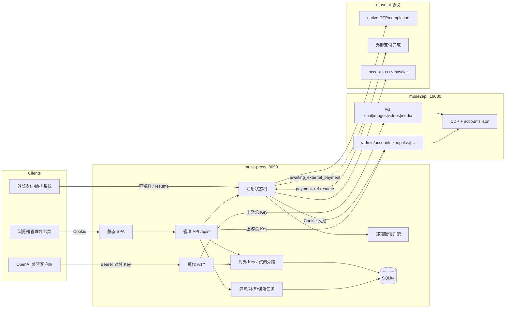
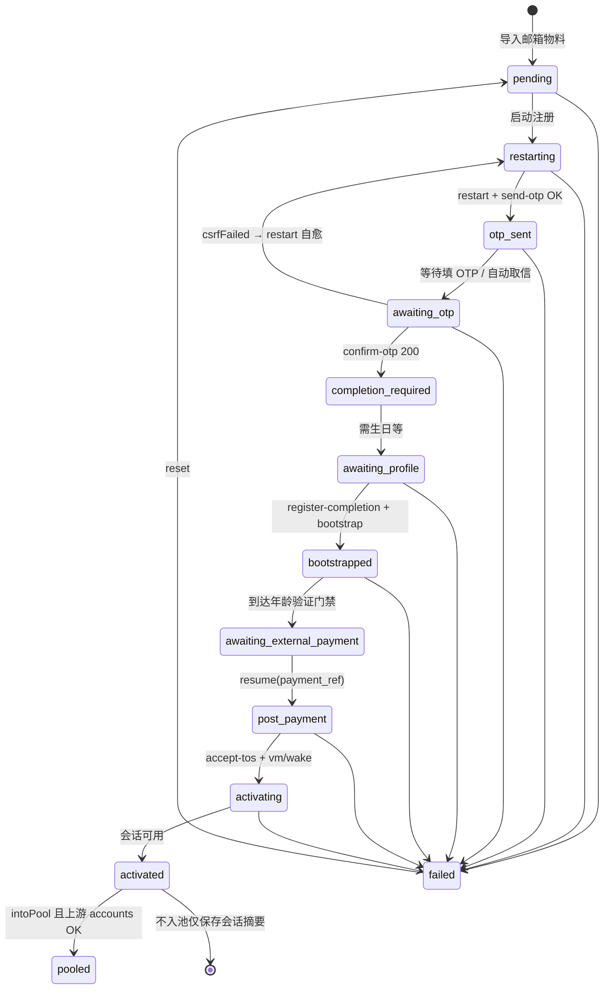
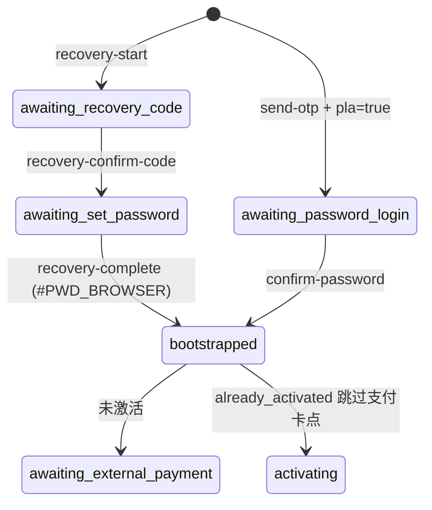

# muse-proxy 完整实施方案

> **权威文档**：本文（`/workspace/muse-proxy-full-plan.md`）为准。  
> `/workspace/muse-proxy-design.md` 已同步对齐；若冲突，**以本 full-plan 为准**。  
> 产品名：`muse-proxy`（建议 FastAPI）  
> 对外端口：`:8090`  
> **方向修订（2026-11-05 07:32 CST / Asia/Shanghai，待用户确认后再改代码）**：不再把本服务当 muse2api HTTP 反代去打 `http://127.0.0.1:19080` / `http://82.29.130.4:19080`；改为**参考** GitHub [`czg86389-hub/muse2api`](https://github.com/czg86389-hub/muse2api)（及 `/workspace/muse2api-analysis.md`、`/opt/muse2api`、`/workspace/muse2api-src`）把 Muse.ai 能力**内嵌**到本仓，与小AD 式注册/管理后台同进程。详见 **§12**。  
> 同机对照：Firefly / 神奇的小AD 5.1 `:8080`（端口仍分离）  
> 协议依据：`/workspace/muse-signup-protocol-v2.md`、`/workspace/muse-protocol-full.md`、`/workspace/muse-models-re.md`  
> 引擎对照：`/workspace/muse2api-analysis.md`  
> 修订日：2026-11-05（Asia/Shanghai）  
> **文档禁止写入真实 Cookie / 密钥 / 卡号 / CVV / 有效期。**  
> **本节前的 §0–§11 描述旧「反代 19080」形态；若与 §12 冲突，以 §12 为准（待确认）。**

---

## 0. 文档优先级与已确认范围摘要

| 项 | 结论 |
|----|------|
| 产品形态（**§12 新方向，待确认**） | **内嵌** Muse 生成引擎（对齐 muse2api 对外 API）+ 小AD 式七页注册/号池/补号 **同仓同进程**；**不再** HTTP 反代 `*:19080` |
| 对外 API | 自实现 OpenAI 兼容：`/v1/chat/completions`、`/v1/images/*`、`/v1/videos*`、`/v1/models`、`/v1/media`（请求/响应形状对齐 muse2api README） |
| 号池真相（**§12 新方向**） | **本库 SQLite 为权威**（Cookie / 指纹 / 代理 / 额度缓存 / 启用态）；注册成功直接入本池，不再「推到上游 /admin/accounts」 |
| 注册 | 仍：状态机 + 填资料 API；支付 = 外部完成；`awaiting_external_payment` + `resume`（**无卡**） |
| 邮箱口令 / Cookie | 导入格式、任务态、收信、入池 **对齐小AD 补号/子号** |
| **禁止** | 卡池、卡批量导入、checkout/PTT/JWE/代扣；**禁止**卡号/CVV/有效期入库；**禁止**依赖或转发到第三方 muse2api 实例 |
| 旧形态（§1–§11） | 「反代 19080 + 号池代理上游」——**仅作历史实现说明**；确认 §12 后按里程碑拆除 `upstream_*` 转发路径 |

---

## 1. 产品定位与非目标

### 1.1 定位（一句话）

给本机 muse2api 加一层 **OpenAI 兼容反代网关** + **小AD 同构七页运维后台**：对外多 Key 计量转发；对内代理号池/保活；并提供 **Muse 注册编排**（邮箱 OTP → 资料补全 → **外部支付卡点** → accept-tos / wake → Cookie 入上游池）。

### 1.2 目标（首版必须交付）

1. `/v1/*` 反代：chat（SSE）、images、videos、models、media（可鉴权回源）。
2. 管理台七页：`overview / generate / records / accounts / subs / refills / settings`，交互贴近小AD（hash 路由、cookie 登录、toast/ask/modal、分页、401→登录）。
3. 号池页代理 muse2api admin，**本库不存完整号池 Cookie 权威副本**。
4. 导号/注册（`subs`）+ 补号/保活与邮箱物料（`refills`）任务流；邮箱口令导入对齐小AD。
5. 注册填资料 API；支付仅 `awaiting_external_payment` + `POST …/resume`（`payment_ref` 占位）。
6. 调用/生成记录、多对外 Key、设置页上游与网关配置。

### 1.3 非目标与禁止项

| 不做 / 禁止 | 说明 |
|-------------|------|
| 卡池、卡批量导入 | 用户明确「卡不要你做」；界面与表结构 **无** 卡字段 |
| checkout / PTT / JWE / 代扣脚本 | 支付由 **外部系统** 完成 |
| 卡号、CVV、有效期、持卡人地址入库 | **硬禁止**；resume 只用 `payment_ref` 等非卡密字段 |
| 本进程重做 Chromium/CDP 生成引擎 | 生成仍由 muse2api `engine` |
| SQLite 第二套 Muse 号池真相 | 列表以每次上游响应为准 |
| Adobe 邮箱注册协议本体 / ARP 铸票 / R2（小AD 专属） | 不移植；仅复用「邮箱物料 + 任务 UX」 |
| 支付商城、自助套餐发卡 | 多 Key 为自用计量 |
| 文档或日志打印真实 Cookie/上游总 Key | 脱敏 / 前后缀预览 |

---

## 2. 系统架构



**对外 API 主路径**

```text
Client Bearer 对外Key
  → 鉴权 / 日限 / 额度 / 模型白名单
  → Authorization: Bearer <UPSTREAM_KEY>
  → 转发 UPSTREAM_BASE + path（SSE 逐块透传）
  → 可选改写 /v1/media URL
  → 写 call_logs + 扣减额度
```

**注册主路径（无卡）**

```text
导入邮箱物料 → restart → send-otp →（取信 OTP）→ confirm-otp
  → register-completion（生日等填资料）
  → Meta bootstrap（服务端代跑，若实现）
  → 状态 awaiting_external_payment   ← 卡点，本系统停
  → 外部完成支付后 POST …/resume { payment_ref }
  → accept-tos → vm/wake
  → 抽出 Cookie → 可选 POST 上游 /admin/accounts → pooled
```

---

## 3. 七页功能说明书

侧栏与小AD一致：

```text
location.hash → overview|generate|records|accounts|subs|refills|settings
默认 #overview；非法 → overview
```

交互横切：`api()` + `credentials:'same-origin'`、401→`/login.html`、`toast`/`ask`/`modal`、`esc()`、统一分页、切页 `clearInterval(timer)`。  
登录：`POST /api/login` `{ user, password }`；`GET /api/me`；`POST /api/logout`。

### 3.1 总览 `overview`

| 维 | 内容 |
|----|------|
| **用户操作** | 看今日/累计调用成功率（可分 chat/image/video）；切换 6h/24h/7d；看上游 health/ready 与号池概况；看对外 Key 启用数与近 24h Top；事件流；手动刷新 |
| **数据来源** | 本库 `call_logs` 聚合；上游 `GET /admin/status`、`/healthz`、`/readyz`；可选本库 `events` |
| **关键 API** | `GET /api/overview`；`GET /api/metrics`；`GET /api/stats/series?range=` |

### 3.2 生图生视频 `generate`（含对话试调）

| 维 | 内容 |
|----|------|
| **用户操作** | 模式：`chat` / `t2i` / `i2i` / `t2v` / `i2v`；选模型；提示词与参考图；立即生成；右侧画廊≈9；对话 SSE 流式区；本地偏好 `gen_sel`（**不**存上游总 Key） |
| **数据来源** | `GET /v1/models`（经反代）；任务状态来自 `/v1/images/tasks/{id}`、`/v1/videos/{id}` 与 records |
| **关键 API** | `POST /api/generate/token`；`GET /api/generate/models`；`GET /api/generate/gallery`；实际生成走 **`/v1/chat/completions`、`/v1/images/*`、`/v1/videos*`**（内部短时 Key 或 Cookie+CSRF 旁路） |

轮询：优先单一 `watchTask`，避免小AD 双轮询打架。

### 3.3 生成记录 `records`

| 维 | 内容 |
|----|------|
| **用户操作** | 状态筛（全部/成功/失败/进行中）；搜 path/model/prompt/Key/错误/ID；详情 modal（媒体、日志感字段、latency、source）；清理失败/N 天前/ids/全部（跳过进行中） |
| **数据来源** | 本库 `call_logs`（+ 可选异步 `generation_jobs`） |
| **关键 API** | `GET /api/records`；`GET /api/records/{id}`；`POST /api/records/delete` |

### 3.4 号池管理 `accounts`

| 维 | 内容 |
|----|------|
| **用户操作** | 列表/筛/搜/分页；导入 Cookie（文本或文件，格式兼容 muse2api）；行：检测、编辑标签/代理/Cookie、启停、删除；批量检测/启停/删；导出 |
| **数据来源** | **实时代理** muse2api `/admin/accounts*`；概况可拼 `/admin/status` |
| **关键 API** | `/api/accounts`、`/import`、`/{id}`、`/{id}/cookies`、`/{id}/check`、`/batch`、`/export` → 上游 `/admin/accounts*` |

**硬约束**：本库 **不** 存完整 Cookie 权威副本。

### 3.5 导号 / 注册激活 `subs`（对齐小AD「子号激活」位）

| 维 | 内容 |
|----|------|
| **用户操作** | 导入邮箱物料（见 §6）；选 region/国家、是否入池；批量启动注册 / 重试 / 重置 / 删除；进度条+停止；运行日志；单行收件箱；对卡在支付步的任务展示「等待外部支付」并支持管理员触发/查看 resume 状态 |
| **数据来源** | 本库 `signup_jobs` / `signup_items` / 邮箱密文；上游仅在入池时写入 |
| **关键 API** | `/api/subs*`（列表/import/batch/task/stop/export/mail）；填资料与 resume 见 §5（可挂在 `/api/subs/{id}/…` 或 `/api/signup/…`，实现时二选一，文档推荐挂 `subs` 以对齐七页） |

状态展示对齐小AD芯片：`pending / running / activated / failed`，并扩展：`awaiting_profile`、`awaiting_otp`、`awaiting_external_payment`、`pooled`。

### 3.6 补号系统 `refills`（对齐小AD「补号」位）

小AD 补号 = 邮箱导入 → 普号注册 → Cookie 入池 + 看门狗。本系统映射为两块能力（同一页分区或 Tab）：

**A. 邮箱物料与入池（对齐小AD 补号 UX）**

- 同一套邮箱口令导入格式、任务条、收件箱、导出、入池开关。
- 执行策略可配置：`mode=signup`（走与 subs 相同注册状态机）或 `mode=cookie_import`（行内已有 Cookie 则直接推上游）。

**B. 保活 / 续签队列（对齐 muse2api 运维）**

- 全池/单号 keepalive、test、relogin、quota；进度与日志同构小AD 补号任务条。

| 维 | 内容 |
|----|------|
| **用户操作** | 导入邮箱；启动补号/入池；看门狗设置（设置页）；批量 keepalive/test/relogin/quota；日志与停止 |
| **数据来源** | 本库 `refill_items` + `keepalive_jobs`；账号列表合并上游 |
| **关键 API** | `/api/refills*`；`/api/refills/keepalive/*` 或 batch action 区分 |

### 3.7 系统设置 `settings`

| 卡片 | 内容 |
|------|------|
| 上游连接 | base URL、总 Key（遮罩）、测试连通 |
| 网关 | 超时、并发、`max_body_bytes` |
| 媒体 | `media_auth_required`、`rewrite_media_urls`、`PUBLIC_BASE` |
| 控制台试调 | `console_generate_enabled` |
| 记录 | `record_keep_days` |
| 注册 / 补号 | 默认 region、入池默认、并发、OTP 超时、是否自动取信、`PROXY_SCHEDULED_KEEPALIVE` |
| 对外默认限额 | 新建 Key 默认额度/日限 |
| 安全 | 管理员、新密码、会话 TTL |
| **对外密钥**（页底） | 多 Key CRUD（明文仅创建时一次） |

---

## 4. 反代 `/v1` 路由与鉴权

### 4.1 鉴权通道

| 通道 | 方式 | 失败 |
|------|------|------|
| 管理 `/api/*`（除 login） | Cookie 会话 | 401 |
| 对外 `/v1/*` | `Authorization: Bearer <对外Key>` | 401/403/429 |
| 管理台试调 | 短时 `kind=console` Key 或 Cookie+CSRF 旁路 | 403 若关闭试调 |
| 健康/静态 | 无 | — |

回源 muse2api：**始终**换上游总 Key；**不**转发客户端 Cookie 到上游。

### 4.2 路由白名单

| Method | Path | 备注 |
|--------|------|------|
| GET | `/v1/models` | 可按 Key 白名单过滤 |
| POST | `/v1/chat/completions` | **SSE 原样透传**（含 `[DONE]`） |
| POST | `/v1/responses` | 流式透传 |
| POST | `/v1/images/generations` | |
| POST | `/v1/images/edits` | multipart 透传 |
| POST | `/v1/images/tasks` | 异步 |
| GET | `/v1/images/tasks/{task_id}` | |
| POST | `/v1/videos` | |
| POST | `/v1/videos/generations` | 别名 |
| GET | `/v1/videos/{task_id}` | |
| GET | `/v1/videos/generations/{task_id}` | |
| GET | `/v1/media/{name}` | 可要求 Bearer；禁路径穿越；回源 |

**不对外暴露** muse2api `/admin/*`（仅本服务管理 Cookie 经 `/api/accounts|subs|refills` 使用）。

### 4.3 多对外 Key 规则

- 表 `api_keys`：`token_hash`、前缀、`quota_total/used`、`daily_limit/used`、`models_allow`、`enabled`、`kind=user|console`。
- 拒绝：无效 Key、禁用、超额、模型不在白名单 → 对应 401/403/429。
- 计量：已回源默认扣减（`CHARGE_ON_UPSTREAM_ERROR` 可配）；`admin_console` 默认不扣对外额度。
- 并发满：429 `proxy_busy`；上游超时 504；不可达 502。

### 4.4 转发要点

1. 仅白名单路径；替换 Authorization。  
2. 流式不整包缓冲；设 `STREAM_IDLE_TIMEOUT_SEC`。  
3. `rewrite_media_urls`：响应 JSON 内 media → `PUBLIC_BASE/v1/media/...`。  
4. 写 `call_logs`（path、model、latency、source、upstream_status、error 截断）。

---

## 5. 注册状态机 + 填资料 API 草案

### 5.1 状态机（对照协议 v2，支付外置）



| 内部状态 | 含义 | 协议步骤 |
|----------|------|----------|
| `pending` | 已导入，未跑 | — |
| `restarting` | 取 CSRF | `POST /api/auth/native/restart` |
| `otp_sent` / `awaiting_otp` | 已发码，等 OTP | `send-otp` → `confirm-otp` |
| `completion_required` / `awaiting_profile` | 等生日等资料 | `register-completion` |
| `bootstrapped` | Meta bootstrap/OIDC 完成（若实现） | bootstrap + oidc callback |
| **`awaiting_external_payment`** | **硬卡点** | 本系统 **不** 调 checkout/* |
| `post_payment` | 外部已回调 | `resume` 成功 |
| `activating` | 激活收尾 | `accept-tos`、`vm/wake` |
| `activated` | 可用会话；可抽 Cookie | `auth/check` validated（观测） |
| `pooled` | 已推上游号池 | `POST /admin/accounts` |
| `awaiting_recovery_code` | Recovery 等恢复码 | `recovery-start` |
| `awaiting_set_password` | Recovery 等设密 | `recovery-confirm-code` / `recovery-complete` |
| `awaiting_password_login` | 密码登录（免 OTP） | `confirm-password` |
| `failed` / `stopped` | 失败或人工停止 | — |

**CSRF 自愈**：`confirm-otp` 403 `csrfFailed` → 自动 `restart`（`resume:false`）→ 重发 OTP → 回到 `awaiting_otp`（与协议样本一致）。

### 5.1b 旁路：Recovery 设密 / 密码登录 / 邀请码（无卡）

对照 `docs/muse-auth-protocol-full.md`，在 OTP 主路径外增加：



| 状态 | 含义 | 协议 |
|------|------|------|
| `awaiting_recovery_code` | 已发恢复码 | `POST /api/auth/native/recovery-start` |
| `awaiting_set_password` | 等新密码 | `recovery-confirm-code` → `recovery-complete` |
| `awaiting_password_login` | 免 OTP 密码登录 | `send-otp`（`password_login_available`）→ `confirm-password` |

**管理 / Webhook API（无卡）：**

| 方法 | 路径 | 作用 |
|------|------|------|
| POST | `/api/subs/{id}/recovery/start` | 发恢复码 |
| POST | `/api/subs/{id}/recovery/code` | `{ "recovery_code" }` |
| POST | `/api/subs/{id}/recovery/password` | `{ "new_password" }`（拒绝卡字段） |
| POST | `/api/subs/{id}/password/start` | 探测并进入密码登录 |
| POST | `/api/subs/{id}/password` | `{ "password" }` → confirm-password |
| POST | `/api/subs/{id}/invite/redeem` | `{ "code" }` |
| GET | `/api/subs/{id}/invite?create=0\|1` | 查看 / 创建邀请码 |

`#PWD_BROWSER`：mock 客户端本地封装；`SIGNUP_CLIENT=http` 时由可插拔 HTTP 客户端发出。支付仍仅 `awaiting_external_payment` + `resume(payment_ref)`。

`needs` 增补：`recovery_code`、`new_password`、`password`。


### 5.2 填资料 API 草案（给调用方 / 管理台）

鉴权：管理 Cookie **或** 专用 `SIGNUP_WEBHOOK_TOKEN`（Bearer，仅注册回调，权限小于管理员）。

推荐前缀：`/api/subs/{id}/…`（与七页一致）。等价别名 `/api/signup/{id}/…` 可选。

#### 5.2.1 查询任务

`GET /api/subs/{id}`

响应（示意，脱敏）：

```json
{
  "id": "s_xxx",
  "email": "user@example.com",
  "status": "awaiting_external_payment",
  "region": "US",
  "into_pool": true,
  "proxy": null,
  "needs": ["payment_external"],
  "profile": { "date_of_birth": null, "tos_content_version": "…" },
  "otp": { "masked_contact": "u***@example.com", "sent_at": "…" },
  "payment": { "status": "awaiting", "payment_ref": null, "resumed_at": null },
  "upstream_account_id": null,
  "error": null,
  "updated_at": "…"
}
```

`needs` 枚举示意：`email`、`otp_code`、`date_of_birth`、`proxy`、`cookie_manual`、`payment_external`、`recovery_code`、`new_password`、`password`。

#### 5.2.2 填写 / 更新资料（无卡字段）

`POST /api/subs/{id}/profile`

```json
{
  "date_of_birth": "1992-08-16",
  "region": "US",
  "proxy": "socks5://127.0.0.1:1080",
  "note": "可选备注",
  "remember_device": true,
  "tos_content_version": "可选；空则用 confirm-otp 返回值"
}
```

**禁止字段**（出现则 400）：`card_number`、`pan`、`cvv`、`cvc`、`expiry`、`exp_month`、`exp_year`、`card_*`、持卡人地址用于支付的整包卡密等。

#### 5.2.3 提交 OTP

`POST /api/subs/{id}/otp`

```json
{ "otp_code": "123456", "remember_device": true }
```

亦可由服务端自动取信填写（见 §6），管理台仍保留手工入口。

#### 5.2.4 手工补 Cookie（可选逃生舱）

`POST /api/subs/{id}/cookie`

```json
{ "cookie_header": "hatch_sess=…; …", "into_pool": true }
```

执行后可直接标记 `activated`/`pooled`；**明文执行后清空或只留 preview**。

#### 5.2.5 外部支付完成 → 继续

`POST /api/subs/{id}/resume`

```json
{
  "payment_ref": "ext_pay_20261105_xxx",
  "provider": "external",
  "note": "optional"
}
```

语义：

- 仅当 `status == awaiting_external_payment`（或允许幂等重复 resume）时接受。
- **只存** `payment_ref` / `provider` / 时间戳；**禁止**任何卡密。
- 成功后转入 `post_payment` → 跑 `accept-tos` + `vm/wake` → 抽 Cookie → 按 `into_pool` 推上游。

#### 5.2.6 批量 / 控制（对齐小AD）

| Method | Path | Body 要点 |
|--------|------|-----------|
| POST | `/api/subs/import` | `{ text, country/region }` |
| POST | `/api/subs/batch` | `{ ids\|all, action, country, intoPool }`；action: `activate\|retry\|reset\|delete` |
| POST | `/api/subs/stop` | — |
| GET | `/api/subs/task?after=` | 进度 + 增量日志 |
| GET | `/api/subs/{id}/mail` | 收件列表 |
| GET | `/api/subs/{id}/mail/message?id=` | 单封（HTML **须消毒** 后展示） |

---

## 6. 导号 / 补号（邮箱口令 · Cookie）与小AD 对照

依据：`/tmp/ad_app.js` 子号/补号导入文案与 API；服务器 `fireflyd` 路由字符串；`app.db` 表 `sub_accounts` / `refill_accounts` / `accounts`（仅结构，样本已脱敏）。

### 6.1 邮箱口令导入格式（对齐小AD）

每行一条，分隔符：`----` 或 `|` 或 Tab。

| 格式 | 字段 |
|------|------|
| **6 段** | `主邮箱----密码----ClientID----RefreshToken----辅助邮箱----辅助密码` |
| **4 段** | `主邮箱----密码----ClientID----RefreshToken`（无辅助邮箱；取信能力可能降级） |

小AD UI 文案：重复邮箱 **只更新凭据**，不重置指纹/状态。  
`mailReady`：凭证段齐全为 true，否则芯片「缺失」。

**muse-proxy 行为**

- 导入写入 `signup_items` / `refill_items`；密码与 refresh 等 **加密落库**（Fernet/age 等），API 列表 **不回说明文**。
- `mailReady` 逻辑同小AD。
- 取信：优先 Graph（ClientID+RefreshToken）；失败可降级 IMAP（若配置）。用于抽取 Muse OTP 邮件。

### 6.2 Cookie 导入格式（对齐小AD号池 + muse2api）

| 来源 | 格式 |
|------|------|
| 小AD 号池 | 每行 `Cookie` 或 `备注名----Cookie`；`POST /api/accounts/import` `{ text, replace }` |
| 小AD 推号示例 | JSON `{"kind":"…","text":"标签----完整Cookie\\n…"}` 或 `accounts[{cookie,name,kind}]` |
| muse2api | `cookie_header` / 扩展导号；核心 Cookie 含 `hatch_sess` 等 |

**muse-proxy**

- `accounts` 页导入 → 直接代理上游 `POST /admin/accounts`（循环/批量）。
- `subs`/`refills` 成功激活后若 `intoPool`：组装 `cookie_header` 推上游，本库只留 `cookie_preview` + `upstream_account_id`。

### 6.3 任务状态对照

| 小AD（subs/refills） | muse-proxy 扩展 | 说明 |
|---------------------|-----------------|------|
| `pending` | `pending` | 待执行 |
| `running` | `running` / 细分态 | 执行中 |
| `activated` | `activated` | 注册/激活成功 |
| `failed` | `failed` | 失败 |
| `pooled` / `poolState` | `pooled` | 已入号池 |
| — | `awaiting_otp` | 等 OTP |
| — | `awaiting_profile` | 等生日等 |
| — | **`awaiting_external_payment`** | **等外部支付** |

batch body 对齐小AD Go 结构线索：

```text
ids []string | all bool | status | q | action | country | intoPool *bool
action: activate | retry | reset | delete
```

### 6.4 邮箱取信对照

| 小AD | muse-proxy |
|------|------------|
| `GET /api/subs\|refills/{id}/mail` | 同路径形状 |
| `GET …/mail/message?id=` | 同；**HTML 消毒**（小AD 直出有 XSS 面，本系统要修） |
| 辅助邮箱收验证码 | Muse OTP 同样走主/辅邮箱取信 |
| `secret` 大字段存凭据（Firefly refill 样本） | 本系统拆列加密，避免单 blob 明文 |

### 6.5 Cookie 入池对照

| 小AD | muse-proxy |
|------|------------|
| 激活成功且 `intoPool` → 写入本库 `accounts` | 激活成功且 `into_pool` → **上游** `POST /admin/accounts` |
| 号池检测 `/api/accounts/{id}/check` | 代理 `POST /admin/accounts/{aid}/test` |
| 本库 `accounts.data` JSON 含 cookie | **禁止**第二套权威 Cookie；最多临时 `cookie_blob` 执行后清空 |

### 6.6 Firefly DB 结构线索（只读归纳）

| 表 | 形态 |
|----|------|
| `accounts` / `sub_accounts` / `refill_accounts` / `r2_accounts` | `id TEXT` + `data TEXT`（JSON 文档） |
| `kv` | 设置 KV |
| `records`（库 `records.db`） | 宽表记录表 |

refill 样本键（脱敏）：`email, secret, country, status, message, tries, profile, lastSid, cookie, hasCookie, pooled, createdAt, updatedAt, activatedAt`。  
accounts 样本键：`cookie, email, enabled, credits*, success/fail, importedAt, seed, note, userId, …`。

---

## 7. 数据模型（SQLite · **无卡字段**）

路径默认：`data/muse-proxy.db`。

### 7.1 表清单

| 表 | 用途 |
|----|------|
| `admin_users` / `sessions` | 管理登录 |
| `api_keys` | 对外/试调 Key |
| `call_logs` | 反代调用记录 |
| `settings` | KV 配置 |
| `signup_items`（subs） | 注册/导号行 |
| `signup_task_logs` | 增量日志 |
| `refill_items` | 补号邮箱物料行 |
| `keepalive_jobs` / `keepalive_logs` | 保活队列 |
| `events` | 可选总览事件 |

### 7.2 `api_keys`（摘要）

`id, name, token_hash, token_prefix, kind(user|console), enabled, quota_total, quota_used, daily_limit, daily_used, daily_reset_on, models_allow, expires_at, timestamps`

### 7.3 `call_logs`（摘要）

`id, key_id, method, path, api_type, source(external|admin_console), model, stream, status, http_status, upstream_status, error, latency_ms, prompt_preview, upstream_task_id, media_urls, timestamps`

### 7.4 `signup_items`（注册 · **无卡列**）

| 字段 | 说明 |
|------|------|
| id, email | |
| secret_enc | 邮箱口令物料密文（密码/ClientID/Refresh/辅邮等） |
| mail_ready | 0/1 |
| region / country | |
| proxy | 可选 |
| status | 见状态机 |
| profile_json | **仅** dob、tos_version、remember_device 等非卡资料 |
| otp_meta_json | masked_contact、sent_at 等 |
| payment_ref | **外部**支付引用字符串，可空 |
| payment_provider | 如 `external` |
| payment_resumed_at | |
| cookie_preview | 前后缀 |
| cookie_blob | 可选临时；入池或超时后清空 |
| into_pool | 0/1 |
| upstream_account_id | |
| tries, last_error, message | |
| csrf_meta_enc | 可选：waterfall/csrf 会话态密文 |
| created_at, updated_at, activated_at | |

**显式不建列**：`card_number`、`pan`、`cvv`、`cvc`、`expiry_*`、`card_holder`、`billing_address` 用于代扣的字段、`ptt`、`jwe`、`platform_trust_token` 等。

### 7.5 `refill_items`

与 `signup_items` 同构精简版（邮箱物料 + status + into_pool + upstream_account_id）；若 `mode=keepalive_only` 可不跑注册。

### 7.6 `keepalive_jobs` / `keepalive_logs`

`action: keepalive|quota|test|relogin|retry`；`scope: all|ids`；日志按 account_id。

### 7.7 明确不存

- 卡密与支付密文  
- Muse 账号 Cookie 权威全集  
- 上游 `tasks.json` 全量镜像  

---

## 8. 目录结构 · 配置 · 部署

### 8.1 目录

```text
muse-proxy/
├── README.md
├── .env.example
├── requirements.txt / pyproject.toml
├── docker-compose.yml
├── Dockerfile
├── app/
│   ├── main.py
│   ├── config.py
│   ├── db.py
│   ├── models.py
│   ├── auth_admin.py
│   ├── auth_api.py
│   ├── proxy.py                 # /v1 SSE 转发
│   ├── upstream_admin.py        # muse2api /admin 客户端
│   ├── signup/
│   │   ├── machine.py           # 状态机
│   │   ├── protocol.py          # restart/otp/completion/tos/wake（无 checkout）
│   │   ├── mailer.py            # Graph/IMAP 取信
│   │   └── crypto.py            # 凭据加解密
│   ├── jobs_refill.py
│   ├── jobs_keepalive.py
│   └── routers/
│       ├── health.py
│       ├── v1.py
│       ├── admin_auth.py
│       ├── overview.py
│       ├── generate.py
│       ├── records.py
│       ├── accounts.py
│       ├── subs.py              # 含 profile/otp/resume
│       ├── refills.py
│       └── settings.py
├── static/                      # login.html index.html app.css app.js
└── data/muse-proxy.db
```

### 8.2 关键环境变量

```bash
HOST=0.0.0.0
PORT=8090
PUBLIC_BASE=http://127.0.0.1:8090
TZ=Asia/Shanghai
DATABASE_URL=sqlite:///./data/muse-proxy.db
ADMIN_USER=admin
ADMIN_PASSWORD=change-me
UPSTREAM_BASE_URL=http://127.0.0.1:19080
UPSTREAM_API_KEY=
CONNECT_TIMEOUT_SEC=10
REQUEST_TIMEOUT_SEC=600
STREAM_IDLE_TIMEOUT_SEC=120
MAX_CONCURRENCY=8
MEDIA_AUTH_REQUIRED=true
REWRITE_MEDIA_URLS=true
CONSOLE_GENERATE_ENABLED=true
RECORD_KEEP_DAYS=30
SIGNUP_CREDENTIALS_KEY=          # 邮箱物料加密主密钥
SIGNUP_WEBHOOK_TOKEN=            # 外部 resume/填资料用
PROXY_SCHEDULED_KEEPALIVE=false
TOKEN_PREFIX=mprox_
```

### 8.3 同机端口共存

| 服务 | 端口 |
|------|------|
| Firefly 小AD | `:8080` |
| muse-proxy（本系统） | `:8090` |
| muse2api（宿主机） | `:19080` → 容器 `18610` |

部署：独立 systemd 或 `docker-compose`；**不要**占用 8080/19080。首版可先本机 venv 跑通，再容器化。  
**本阶段不向生产强推部署**；以文档与本地脚手架为准。

---

## 9. 里程碑 M1–M8

| 里程碑 | 交付 | 验收 |
|--------|------|------|
| **M1** | 脚手架 + SQLite + 登录 + **七页空壳** + healthz | 七页可切换；401→登录 |
| **M2** | `/v1` 反代：models + chat **SSE** + 错误映射 + 上游配置 | curl `:8090` 流式对话成功 |
| **M3** | images/videos/media；媒体鉴权与 URL 改写；`call_logs` | 图/视频/媒体经反代有记录 |
| **M4** | **generate** 试调页 + `/api/generate/token` | ✅ 管理台能对话/出图，无需 curl |
| **M5** | **records** + 设置底 **多 Key** 额度日限 | ✅ 限额生效；记录可筛可清 |
| **M6** | **accounts** 代理上游号池 | ✅ 与 muse2api 同批号；无第二套 Cookie 真相 |
| **M7** | **subs**：邮箱导入 + OTP/资料 API + 状态机至 `awaiting_external_payment` + **resume** + tos/wake + 入池；**无卡** | ✅ 外部 payment_ref 后续跑通入池；库表无卡列 |
| **M8** ✅ | **refills** 邮箱物料 UX + keepalive 队列；**overview/settings** 收口；README | ✅ 闭环：导入→注册卡点→resume→号池→保活→试调→记录；overview 有数字；mock keepalive |

注册无卡能力放在 **M7+**；M1–M6 不阻塞反代与七页壳。

延期：支付实现、Adobe/R2/ARP、本库权威号池、公网一键升级 muse2api、多节点 Postgres。

---

## 10. 验收清单

### 10.1 反代与鉴权

- [ ] `GET /healthz` 200  
- [ ] 无 Key 调 `/v1/models` → 401  
- [ ] 有效对外 Key：models / chat SSE / 文生图或视频（依赖上游有号）  
- [ ] 媒体：开启鉴权时无 Key → 401；有 Key 可拉文件  
- [ ] 超额 / 日限 → 429；错误码稳定  

### 10.2 管理台七页

- [ ] 登录登出与小AD 同形  
- [ ] 七页路由与侧栏文案齐全  
- [ ] generate 试调出结果进画廊且 records 可见 `source=admin_console`  
- [ ] records 清理不影响进行中  

### 10.3 号池

- [x] 列表与 muse2api admin 一致（经 `/api/accounts` 代理 + mock 验收）  
- [x] 导入 Cookie 后上游可见  
- [x] 本库无完整 Cookie 持久权威副本  

### 10.4 注册 / 补号（无卡）

- [x] 6 段/4 段邮箱导入；`mailReady` 正确  
- [x] 可 `profile` / `otp`；拒绝卡字段 400  
- [x] 到 `awaiting_external_payment` 后协议侧 **无** checkout 调用  
- [x] `resume { payment_ref }` 后续 accept-tos/wake/入池  
- [x] 收件 HTML 经消毒  
- [x] DB schema 扫描无卡列名  

### 10.5 同机共存

- [ ] `:8090` 与 `:8080`、`:19080` 并行无端口冲突  

### 10.6 安全文档

- [ ] README / 本方案无真实密钥 Cookie 卡号  

---

### 10.5 M8 overview / refills / settings

- [x] `#overview` 今日/累计成功率、by_type、ov_range、上游 health、号池、Key 启用、失败事件  
- [x] `#refills` 邮箱导入列表 + keepalive 队列（全池/单号 test·relogin·quota·keepalive）  
- [x] 本库仅 `refill_items` / `keepalive_*` 任务态；无卡列  
- [x] `#settings` 上游遮罩、超时并发、媒体、试调、保留、管理员密码、测试连通、密钥子区  
- [x] README 写清 M1–M8 启动与验收；不部署 82.29、不写真实密钥  


## 11. 给主助手：下一步开工顺序（≤10）

1. **以本文为权威**，把 `muse-proxy-design.md` 页眉改为「细节以 full-plan 为准」并保留实现用 API 表。  
2. 初始化仓库 `muse-proxy/`：FastAPI 骨架、`config`、SQLite、`/healthz`、login 会话、**七页空壳 SPA**（M1）。  
3. 实现 `proxy.py`：`/v1/models` + `/v1/chat/completions` SSE 透传与基础错误映射（M2）。  
4. 补齐 images/videos/media + `call_logs`（M3）。  
5. 做 generate 试调 token + 画廊（M4）与 records + 多 Key（M5）。  
6. 接 `upstream_admin`，落地 accounts 代理页（M6）。  
7. 实现邮箱导入/加密/取信骨架与 **subs 状态机到 `awaiting_external_payment`**；暴露 `profile`/`otp`/`resume`（M7）。  
8. 接 accept-tos、vm/wake、Cookie 入上游池；HTML 邮件消毒。  
9. 做 refills 页（邮箱 UX + keepalive 队列）与 overview/settings 收口（M8）。  
10. 按 §10 跑验收；**不**实现任何卡池/checkout；**不**把真实密钥写入文档或示例。

---

## 附录 A · 与旧 design 文档关系

| 主题 | design 原稿 | full-plan 调整 |
|------|-------------|----------------|
| subs 语义 | 偏 Cookie 导号 | **注册状态机 + 邮箱物料 + 外部支付钩子**；Cookie 导号仍保留为逃生舱/accounts |
| refills 语义 | 仅 keepalive | **小AD 补号 UX（邮箱）+ keepalive** |
| 支付 | 未写 | **显式外置**；禁止卡入库 |
| 权威 | design | **本文** |

## 附录 B · 参考路径

- `/workspace/muse-proxy-design.md`  
- `/workspace/muse2api-analysis.md`  
- `/workspace/firefly-frontend-map.md`  
- `/workspace/muse-signup-protocol-v2.md`  
- `/tmp/ad_app.js`（小AD 前端）  
- 服务器：`/opt/firefly`、`/opt/muse2api`（只读对照；本文不写其密钥）


---

## 12. 方向修订：内嵌 muse2api 能力（不再反代 19080）【待用户确认 · 勿先大规模改代码】

> **触发**：用户明确纠正——不要把 `muse-proxy` 当反代去请求 `http://82.29.130.4:19080`（或本机 `127.0.0.1:19080`）；要参考 [czg86389-hub/muse2api](https://github.com/czg86389-hub/muse2api) 的**接口形状与能力清单**，在本仓**重新做一套**「小AD 式注册/管理 + Muse 反代式 OpenAI API」一体项目。  
> **状态**：仅文档方案；**确认前禁止**大面积改 `app/proxy.py` / 拆装引擎。  
> **无卡**：支付仍外置；本方案不包含卡池/checkout/PTT/JWE。

### 12.1 一句话目标

**一个进程（`:8090`）同时提供：**

1. 小AD 同构七页：号池 / 补号（邮箱物料）/ 导号注册 / 生成试调 / 记录 / 总览 / 设置；  
2. OpenAI 兼容对外 API：对话、文生图、图生图、文生视频、图生视频；  
3. 多账号池轮转 + 会话保活（文档所称「48h 自动续期」按 muse2api 真实语义实现，见 §12.5）；  

**生成流量直接打 muse.ai（经本进程内嵌引擎），不经任何外部 muse2api HTTP 上游。**

### 12.2 与旧方案差异对照

| 维度 | 旧方案（§1–§11） | 新方案（本节） |
|------|------------------|----------------|
| `/v1/*` | `httpx` 转发到 muse2api `:19080`，换 Bearer | **本进程实现**；无 `UPSTREAM_BASE_URL` 业务依赖 |
| 号池权威 | muse2api `data/accounts.json`；本库只代理 | **本库 SQLite**（加密存 Cookie）；管理页读写本地 |
| 保活 | 代理 `/admin/accounts/*/keepalive` 等 | **本进程**调 `GET https://muse.ai/api/session` ± `POST /api/hatch/vm/wake` |
| 注册入池 | Cookie → `POST` 上游 `/admin/accounts` | Cookie → **本库号池表**，立即可被调度 |
| 设置页「上游」 | 填 19080 + muse2api Key | 改为：**Chromium 路径 / CDP 端口 / 并发 / 超时 / 站点代理**；去掉「上游 Base URL」业务项（或标废弃） |
| 同机 muse2api | 依赖其常驻 | **可选对照/迁移源**；生产路径不依赖 |

### 12.3 参考源（只读对照，不把对方当运行时上游）

| 源 | 用途 |
|----|------|
| GitHub `czg86389-hub/muse2api` README | 对外 API 路径、请求字段、异步任务约定、环境变量语义 |
| `/workspace/muse2api-analysis.md` | 模块职责、调度/续签/并发事实 |
| `/opt/muse2api`、`/workspace/muse2api-src` | 引擎实现细节（`engine.py`/`store.py`/`cdp.py`/`app.py`） |
| `/workspace/muse-models-re.md` | 消费者侧实际走 **Noise `chat.stream`**（加密）；纯 HTTP 生成路径未打通 |
| `/workspace/muse-protocol-full.md` + signup 已实现 | 注册/OTP/设密/accept-tos/wake（HTTP 协议已在本仓） |
| 现有 `muse-proxy` 七页 + 注册状态机 | UX 与物料/号池字段保留并升级为权威存储 |

**许可注意**：muse2api 为 MIT；若移植/改编其 CDP 引擎代码，保留许可证与版权声明；不是「HTTP 反代对方实例」。

### 12.4 关键决策：Chromium/CDP vs 纯 HTTP

| 路径 | 能力覆盖 | 现状证据 | 建议 |
|------|----------|----------|------|
| **A. 内嵌 Chromium + CDP**（muse2api 主路径） | chat SSE、文生图/编辑、文生视频/图生视频、额度面板读取 | 公开源码完整；生成靠页面 DOM + 附件选择器 | **首版采用（推荐）** |
| **B. 纯 HTTP + Noise WS** | 理论上同 A，且更轻 | `wss://hatch.metaaivm.com/v1/noise` 帧**加密未解密**；无稳定明文 `images/generations` | **二期研究**；首版不做硬依赖 |
| **C. 继续反代外部 muse2api** | 同 A | 用户已否决（含 `82.29…:19080`） | **废弃** |

**结论（待确认）**：首版 = **方案 A**：本仓内嵌精简版 `MuseEngine`（CDP）。会话检测/续签/VM wake 继续用**纯 HTTP**（与 muse2api `renew_session_http` 一致）。注册链路继续用现有 **纯 HTTP** signup 协议。  
纯 Noise 客户端仅作为可选后续里程碑，不阻塞首版交付。

### 12.5 「48h 自动续期」真实语义（对齐 muse2api，避免虚报）

- 保活：`GET https://muse.ai/api/session`；必要时 `POST /api/hatch/vm/wake`，再复核 `vm_state==RUNNING`。  
- 写回：**只保存上游实际返回的 Cookie / expires**；**禁止**检测成功就本地虚增 +48h。  
- 文档中的「约 48h」对应 `hatch_vml` 寿命估算（muse2api `VML_TTL≈2d`）；以 Set-Cookie 为准。  
- 后台周期：对齐 muse2api 代码事实约 **15 分钟**扫池（可配置）；临近过期或状态异常优先。  
- 出口：账号级 HTTP/SOCKS5 代理；失败**不**静默回退直连（与 muse2api 一致）。

### 12.6 模块划分（同仓）

```text
muse-proxy/
  app/
    main.py                 # FastAPI 装配
    routers/
      v1.py                 # OpenAI 兼容入口（改：调本地 engine，不再 httpx 上游）
      accounts.py           # 号池 CRUD（改：本地权威）
      subs.py / refills.py  # 注册 + 邮箱补号（保留）
      generate.py / records.py / overview.py / settings.py
    signup/                 # 已有：原生 OTP / 资料 / resume / accept-tos / wake
    muse_engine/            # 【新】自 muse2api 精简移植或重写
      cdp.py                # CDP WebSocket 客户端
      engine.py             # ensure_page / chat_stream / generate(image|video)
      session_http.py       # /api/session + vm/wake
      media_store.py        # data/media + /v1/media
      selectors.py          # DOM 选择器集中配置（易跟版）
    pool/                   # 【新】账号调度
      store.py              # SQLite 账号行 + Cookie 密文
      scheduler.py          # 亲和 sticky + LRU + 同号互斥 + 全局并发槽
      keepalive.py          # 定时保活（取代「代理上游 keepalive」）
    auth_api.py / api_keys.py / call_log.py   # 对外 Key 计量（保留）
    proxy.py                # 【废弃或缩为兼容层】确认后删除对 UPSTREAM_* 的转发
  static/                   # 七页 SPA（号池列/编辑字段已按小AD；设置页改引擎配置）
  data/                     # SQLite + media + chromium profiles
```

**与现有目录映射**

| 现有 | 变更 |
|------|------|
| `app/proxy.py` + `UPSTREAM_*` | 确认后删除转发；`routers/v1.py` 改为调 `muse_engine` |
| `app/upstream_admin.py` | 删除或改为「可选从旧 muse2api JSON **一次性迁移导入**」工具 |
| `app/pool_meta.py` / accounts 代理 | 升为完整号池存储（Cookie 密文、指纹只读、代理、额度缓存、最后使用） |
| `app/signup/*` | 保留；入池目标改为本地 `pool.store` |
| `app/jobs_keepalive.py` | 改为打 muse.ai session，不再打 `:19080/admin/...` |
| 设置页上游连通测试 | 改为：Chromium 可执行探测 + 任选一号 `session` 探测 |

### 12.7 对外 API（形状对齐 muse2api，本进程实现）

鉴权：`Authorization: Bearer <本服务对外 Key>`（现有多 Key / 日限 / 额度逻辑保留）。

| Method | Path | 行为 |
|--------|------|------|
| GET | `/v1/models` | 返回 `muse-spark` / `muse-image` / `muse-video` 及别名（兼容下游常用名） |
| POST | `/v1/chat/completions` | `messages`/`stream`；流式 SSE；内部 `engine.chat_stream` |
| POST | `/v1/responses` | 可选二期；首版可 501 或薄适配 |
| POST | `/v1/images/generations` | 默认同步；`async=true` → 任务 |
| POST | `/v1/images/edits` | multipart/JSON 参考图 |
| POST | `/v1/images/tasks` + GET `.../{id}` | 异步生图（管理台「立即生成」优先走此） |
| POST | `/v1/videos` + GET `.../{id}` | 异步视频；`duration`/`size`/参考 `images` |
| GET | `/v1/media/{name}` | 本地媒体；**建议默认需鉴权或签名 URL**（改进 muse2api 无鉴权风险） |

请求字段以 muse2api README 为准：`prompt`、`size`/`aspect_ratio`、`response_format=url|b64_json`、`images[]`、`duration` 等。  
内部实现：**不**再 `Authorization: Bearer <muse2api key>` 去打 19080。

### 12.8 对接 muse.ai 的接口分层

**A. 注册 / 会话（纯 HTTP，已有 + 保活共用）**

- Native：`/api/auth/native/restart|send-otp|confirm-otp|register-completion|recovery-*|confirm-password`  
- 激活后：`/api/hatch/accept-tos`、`/api/hatch/vm/wake`、`/api/auth/check`  
- 保活：`GET /api/session`（合并 Set-Cookie）  
- **不做**：checkout / PTT / credential / finalize（无卡）

**B. 生成（首版 CDP 驱动网页，等价 muse2api）**

- 浏览器打开 muse.ai 聊天页 → 注入号池 Cookie →（可选）等 VM ready  
- 发提示 / 传参考附件 → 等附件节点 → 下载媒体  
- 对话：轮询/订阅页面助手文本增量 → SSE  
- 底层消费者协议实为 Noise；CDP 路径**绕过**自研 Noise 解密

**C. 号池 Cookie 用法**

- 必需：`hatch_sess`（与 muse2api `ESSENTIAL_COOKIES` 一致）；其它 `hatch_vml` / `hatch_gw` 等有则存、无则不误判未登录  
- 注册成功：从协议客户端 jar 抽出 Cookie 字符串 → 加密写入号池 → `enabled=1`  
- 调度：选号 → 解密 Cookie → CDP context 注入 **或** session HTTP 带 Cookie  
- 编辑页：邮箱、名字、密码、Cookie 可改；**注册指纹只读**（已实现方向保留）  
- 列表列：标签、账号(邮箱)、ID、状态、有效期、额度、启用、Cookie(有/无)、最后使用、备注、操作  

### 12.9 调度与并发（对齐 muse2api 行为）

```text
请求进入
  → 对外 Key 鉴权 / 日限 / 额度
  → 全局并发槽 GEN_LOCK（默认 2，可配）
  → pick_account（亲和 sticky ≈15 次，再 LRU；同号互斥）
  → renew_session_http（10min 内已成功可跳过）
  → engine.ensure_page(独立 BrowserContext + 账号代理)
  → chat_stream | generate(expect=image|video)
  → 媒体落盘 → 写 call_logs → 扣减对外 Key 额度
失败：可换号重试一轮（模型拒答不切号）
```

### 12.10 与「小AD 功能」合并后的产品面

| 页 | 保留/增强 |
|----|-----------|
| overview | 今日调用、成功率、号池健康、保活状态（本地引擎） |
| generate | 试调 chat/图/视频 → **打本机 `/v1`**，结果进画廊 |
| records | `call_logs` 不变 |
| accounts | **本地权威号池**；导入 Cookie / 编辑 / 测试会话 / 读额度 / 单号保活 |
| subs | 注册状态机 + 日志；成功入**本池** |
| refills | 邮箱物料 + 批量注册队列；保活任务打 muse.ai |
| settings | Chromium/CDP/并发/超时/默认代理/对外 Key；**移除**「muse2api 上游 URL」为必填 |

可选：移植 muse2api 的 Chrome/油猴**导号**扩展到本服务导入 API（路径改为本仓 `/api/accounts`）。

### 12.11 数据模型变更要点（确认后实施）

- `accounts`（或升级现表）：`id, label, email, name, password_enc, cookie_enc, fingerprint_json(只读展示), proxy_json, status, enabled, quota_cache, expires_at, last_used_at, last_keepalive_at, note, created_at`  
- `tasks` / `media`：异步图视频任务与文件索引（可借鉴 muse2api `tasks.json` 思路，优先 SQLite）  
- **删除业务依赖**：运行时不再需要 `upstream_base_url` / `upstream_api_key`  
- 迁移工具（可选）：只读解析旧 `accounts.json` → 导入本库（一次性）

### 12.12 部署与依赖

- 系统：Chromium（或 Chrome）、字体、足够 `shm`（Docker 建议 ≥2GB）  
- Python：FastAPI + websocket-client（或等价）+ httpx/requests + SOCKS 支持  
- 端口：对外 **8090**；内部 CDP 默认如 **19211**（避开旧 muse2api 19210，便于同机对照）  
- **不再要求** 19080 进程存活；同机若仍跑旧 muse2api，仅作对照，不串联

### 12.13 建议里程碑（确认后再动代码）

| 阶段 | 内容 | 验收 |
|------|------|------|
| **P0 文档确认** | 用户确认 §12（CDP 首版、本地号池权威、废弃 19080 反代） | 本文勾选 |
| **P1 号池本地化** | accounts 存 Cookie 密文；注册入本池；列表/编辑不经上游 | 补号成功号出现在号池且能「测试会话」 |
| **P2 内嵌引擎骨架** | 移植/重写 cdp+engine；配置 Chromium；单号 chat 冒烟 | `POST /v1/chat/completions` 真站出字 |
| **P3 图/视频** | generations/tasks + videos 轮询；媒体落盘；generate 页 | 文生图/文生视频 completed 有 URL |
| **P4 调度保活** | 多号轮转、亲和、keepalive loop、账号代理 | 双号交替；断 cookie 能标异常 |
| **P5 拆除反代** | 删除 `proxy.py` 上游转发与设置页上游必填；README 改写 | 进程零访问 `:19080` |
| **P6（可选）** | Noise 研究 / `/v1/responses` / 导号扩展 | 另立项 |

### 12.14 风险与非目标（再次强调）

| 风险 / 非目标 | 说明 |
|---------------|------|
| DOM 选择器脆弱 | Muse 改版会导致生成失败；选择器集中配置 + 跟版 |
| 资源占用 | Chromium 内存/CPU 高于纯反代；并发默认宜低 |
| 无卡 | 不实现支付代填；注册停在外部 `payment_ref` |
| 不解密 Noise 不挡首版 | 首版 CDP；不宣称已纯协议生成 |
| 不依赖 `82.29…:19080` | 任何文档/默认配置不得再指向该上游 |
| 不把真实 Cookie/Key 写入文档 | 继续脱敏 |

### 12.15 请用户确认的选择题（确认前不改代码）

1. **首版引擎**：同意 **内嵌 Chromium/CDP**（推荐）？还是坚持先做纯 Noise（当前证据不足，周期长）？  
2. **号池**：同意 **本库 SQLite 为唯一权威**，并废弃「推送到外部 muse2api」？  
3. **同机旧 muse2api**：保留作只读对照，还是迁移 Cookie 后停掉 19080？  
4. **媒体 URL**：是否改为默认鉴权/短时签名（相对 muse2api 更严）？  
5. **代码策略**：在本仓增量改造现有 `muse-proxy`，还是新开子目录/`muse_engine` 包后再拆旧 `proxy.py`？（推荐后者，便于回滚）

---

**§12 记录时间**：2026-11-05 07:32 CST（Asia/Shanghai）。确认答复后，再按 P1→P5 开工；在此之前 **不**大规模改业务代码。

## §12 status (2026-11-05 Asia/Shanghai)

| 阶段 | 状态 |
|------|------|
| P0 文档确认 | done |
| P1 本地号池 Cookie 权威 | done |
| P2 内嵌 CDP chat smoke | done |
| **P3 文生图/视频/图生视频本地 muse_engine** | **done（本机同步）** |
| P4 keepalive 本地循环 | pending |
| P5 拆除 upstream 残余 | pending |

P3：`/v1/images/generations|edits|tasks` + `/v1/videos*` + `/v1/media` 在 `ENGINE_BACKEND=local` 时走 `app/muse_engine` CDP，不再 `_fwd` 19080。号池空 → 502 + 引导导入 Cookie。无卡。Synced to `C:\\Users\\fahai\\muse-proxy`。

